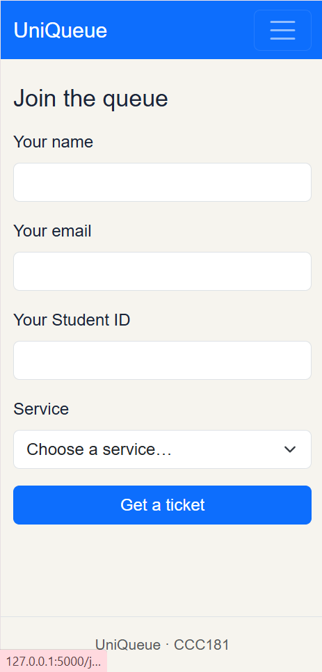
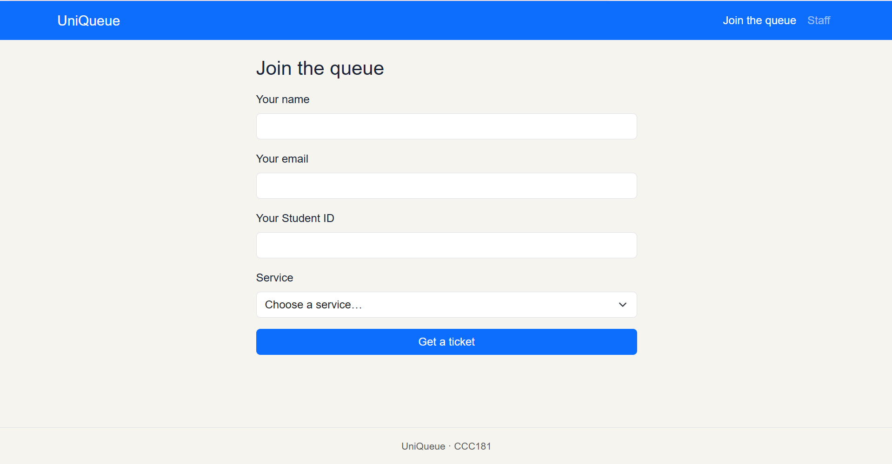

# Part 10: Week 3 Report 

## 1. Title Details
- **App Name:** UniQueue
- **Setting:** PE Uniform Sizing, Payment, and Pickup Queuing System
- **Full Name:** Obrenah Z. Mendoza
- **Student ID:** 2024-1117
- **Section:** CS3B
- **Date:** October 25, 2026
- **Pull Request Link:** https://github.com/aub-zami/CCC181/pull/2

---

## 2. Personas
Below is a summary of the two core user personas developed from research at MSU-IIT for PE uniform sizing, payment, and release. The full persona profiles, scenarios, and top tasks are documented in [`docs/week3/personas.md`](../personas.md).

- **Juane dela Craige (The Person Waiting / Student)**
  > *"I just want to grab my uniform quickly between my morning and afternoon classes without standing under the sun for hours."* *(interview)*
  - **Top Tasks:** 
    1. Join the queue for PE uniform claiming (`/join` — FR-01).
    2. Check live queue position and ticket status (`/queue/<id>` — FR-02).
    3. Leave the queue if class starts (`/queue/<id>` — FR-03).

- **Maria Claria (The Staff Member / Organizer & Cashier)**
  > *"The most exhausting challenge is the lack of sufficient sheltered space to accommodate all students... we cannot fit all students to keep them comfortable while waiting inside the university store."* *(interview)*
  - **Background:** 21, Administrative Staff at MSU-IIT PE Dept / University Store; handles batch-based sizing, payments, and batch distribution (accommodating ~1,000 students per batch).
  - **Top Tasks:** 
    1. Filter active queue by service type (Sizing/Payment vs. Batch Pickup) (`/staff` — FR-04).
    2. Call the next waiting student to regulate the 5-student sizing counter limit (`/staff` — FR-05).
    3. Mark student ticket as Served or No-Show (`/staff` — FR-06).

---

## 3. Screens
Six wireframe layouts were designed and implemented for phone laptop viewports:

1. **Join Screen (Phone):** Used by *Juane* to select a service and request a ticket on mobile (FR-01).  
   

2. **Join Screen (Laptop):** Used by *Juane* or guest users on a larger desktop viewport (FR-01).  
   

3. **My Place Screen (Phone):** Used by *Juane* to track ticket status and live queue position while moving on campus (FR-02, FR-03).  
   

4. **My Place Screen (Laptop):** Used by *Juane* on a laptop screen with full status indicators and action buttons (FR-02, FR-03).  
   

5. **Staff Dashboard Screen (Phone):** Used by *Maria Claria* on a mobile device for quick table navigation and status toggling (FR-04, FR-05).  
   

6. **Staff Dashboard Screen (Laptop):** Used by *Maria Claria* on a desk computer to manage high-volume queue traffic with service filters (FR-04, FR-05).  
   

---

## 4. Design Decisions
1. **Large Position Typography on My Place Page:**  
   *Reason:* Designed directly for Juane, who checks his phone while walking between classes in bright sunlight. The main queue position uses a prominent display font (`display-1`) and clear text labels (*"1 person ahead of you"*) so status is readable at a glance.

2. **Top-Level Service Filter on Staff Dashboard:**  
   *Reason:* Based on Week 1 observations where Sizing/Payment and Uniform Pickup occur as separate physical workflow steps days apart. Placing a filter dropdown at the top of the dashboard allows staff (Maria Claria) to isolate and focus on a single service queue without visual distraction.

3. **Direct Row-Level Action Buttons with `aria-label` Attributes:**  
   *Reason:* While a global "Call Next" macro action was included, table rows feature explicit "Call", "Serve", and "No-Show" buttons per ticket. Each button includes distinct `aria-label` tags (e.g., `aria-label="Call ticket #01"`) to prevent screen-reader ambiguity and support row-level control.

---

## 5. Self-Review
Based on the self-review against usability heuristics in [`docs/week3/feedback.md`](../feedback.md):

- **Join Page:**  
  *Problem:* Initial wireframes lacked immediate inline feedback for missing required fields.  
  *Change:* Implemented server-side validation with Bootstrap `.is-invalid` states and persistent form values so users don't have to retype information on error.

- **My Place Page:**  
  *Problem:* Using color alone (yellow badge) to communicate the `WAITING` status violated accessibility guidelines.  
  *Change:* Added explicit status text inside all badges and included plain-language queue position sentences (*"You're next!"*).

- **Staff Dashboard:**  
  *Problem:* Action buttons in table rows could be easily mis-clicked on small mobile screens.  
  *Change:* Added vertical padding, responsive table wrapping (`.table-responsive`), and distinct button colors (`btn-success`, `btn-outline-danger`).

---

## 6. Accessibility
- **Lighthouse Audit Scores:**
  - **Join Page (`/join`):** 99 / 100
  - **Ticket Page (`/queue/1`):** 100 / 100
  - **Staff Dashboard (`/staff`):** 100 / 100
- **Key Issue Fixed:** Adjusted ticket action buttons and link styling (`btn-danger` and `text-primary-emphasis`).
- Full details, keyboard navigation verification, and manual checklists are recorded in [`docs/week3/accessibility.md`](../accessibility.md).

---

## 7. Usability Test & Improvement
- **Testing Summary:** Tested with a real student persona completing three core tasks (Join queue, check position/ticket number, and perform staff calling/serving actions).
- **Most Serious Issue Identified:** The user was confused when seeing **Ticket #03** alongside **2nd in line (1 person ahead)**, assuming Ticket #3 meant she was 3rd in line for her specific service.
- **Improvement Made:** Added an explanatory helper caption on the My Place screen (`templates/ticket.html`) clarifying that ticket numbers increment sequentially across all services globally, while position reflects the waiting count for that specific service.
- Full usability test observations and before-and-after screenshots are documented in [`docs/week3/usability-test.md`](../usability-test.md).

---

## 8. Reflection
- **What was hardest this week:** Making the "My Place" page update automatically via JavaScript without breaking the page layout or accessibility labels when ticket statuses change (from `WAITING` to `CALLED`, `SERVED`, or `NO-SHOW`).
- **What will change when moving to PostgreSQL in Week 4:** We will replace the temporary Python list (`TICKETS`) with actual database queries. Ticket data will stay saved even if the server restarts, and ticket numbers will be generated automatically by the database instead of counting list lengths.

---

## 9. Declaration
- **AI Tools Used:** Gemini (used as a thought partner for refining Bootstrap utility classes, reviewing Jinja logic, and structuring documentation templates).