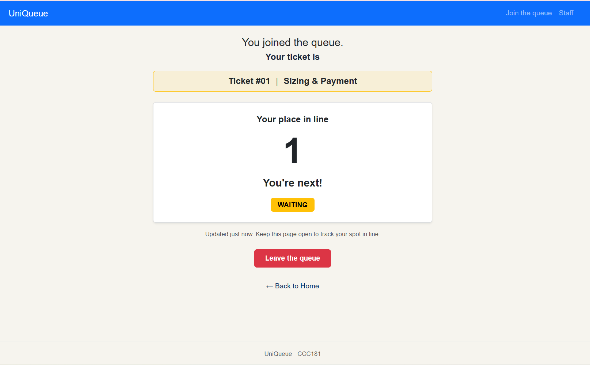
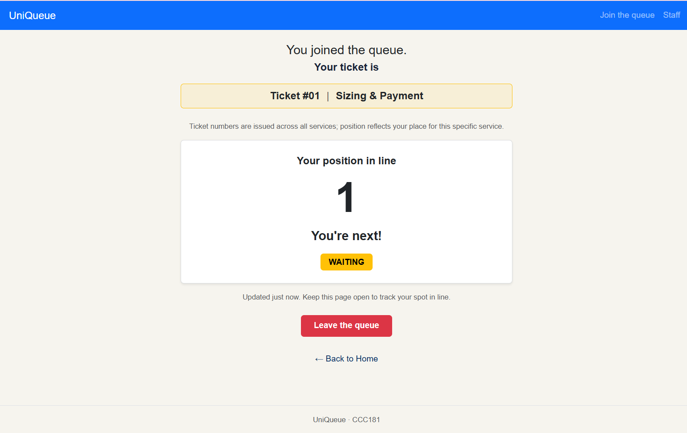

# Part 10: Usability Test & One Improvement

## 10a. Usability Test Results

- **Tester Persona:** Student waiting for PE Uniform / Staff member
- **Testing Method:** In-person user test on local laptop

---

### Task 1: Join the Queue
- **Result:** Finished (Yes)
- **Time Taken:** ~15 seconds
- **Observations / Feedback:** Smooth experience. The user easily navigated to the join form, selected a service, and received a ticket.

---

### Task 2: Check Ticket Number and Position in Line
- **Result:** Finished (Yes, with verbal clarification)
- **Time Taken:** ~30 seconds
- **Observations / Feedback:**
  - Upon seeing the ticket screen, the user immediately reacted: *"Woaaah okay ikaduha pako."*
  - **Hesitation / Confusion:** The user was confused when asked for her ticket number vs. her position. She questioned why her ticket was **#3** while her position was **2nd in line (1 person ahead)**.
  - **Cause:** Because students undergo separate stages—Sizing/Payment in one session and Batch Pickup weeks later—ticket numbers represent global queue entries, whereas position reflects the active queue depth for that specific stage.

---

### Task 3: Staff Dashboard Actions (Call Next & Serve)
- **Result:** Finished (Yes)
- **Time Taken:** ~20 seconds
- **Observations / Feedback:**
  - The user successfully called and served the ticket.
  - **Observation:** Instead of clicking the top **"Call Next"** button, she scrolled down to the table row and clicked the individual **"Call"** button in the actions column because it felt more direct.

---

## Persona Rule 

### Rules That Held Up 

* **Juane Rule #1:** *"Because Juane checks his phone while walking in bright sunlight, his ticket number and status badge must be the largest and clearest elements on the 'My place' page."*
  * **Result:** Held up completely. During testing, the user instantly identified her queue position (*"Woaaah okay ikaduha pako"*), proving that the large typography and high-contrast card hierarchy make status information immediately recognizable at a glance.

* **Juane Rule #2:** *"Because he relies on mobile data, the page must be lightweight and update automatically without requiring full page reloads."*
  * **Result:** Held up completely. Background JS polling fetched queue updates seamlessly without requiring full DOM reloads or heavy data overhead.

* **Juane Rule #3:** *"Because he might need to leave suddenly, a clear 'Leave queue' button must be easily accessible on his ticket page."*
  * **Result:** Held up. The prominent red button was clearly visible and reachable near the bottom of the card with zero friction.

* **Maria Claria Rule #2:** *"Because Sizing/Payment and Claiming occur as separate steps days apart (observation), a service filter dropdown/tabs must be placed right at the top of the dashboard."*
  * **Result:** Held up. Placing the service filter right at the top made it effortless for staff to isolate and manage students waiting for a specific workflow step.

* **Maria Claria Rule #3:** *"Because multiple identical buttons exist in a table, every action button must have proper `aria-label` attributes for accessibility."*
  * **Result:** Held up. Screen reader and DOM inspection confirmed distinct, accessible labels across table rows (e.g., `aria-label="Call ticket #1"`), preventing screen-reader repetition.

---

### Rules That Did Not Hold Up (Failed / Needed Adjustment)

* **Maria Claria Rule #1:** *"Because Maria Claria handles high-volume desk traffic, the 'Call Next' and 'Serve' buttons must be prominent and easy to click with one tap."*
  * **Result:** Partially failed / Needed adjustment. While the top **"Call Next"** button was prominently placed, the user completely bypassed it and clicked the individual **"Call"** button in the specific table row instead because direct row-level action felt more explicit and intuitive to her.

---

## 10b. Most Serious Issue & Improvement

### The Problem
Test user was confused by the distinction between **Ticket Number** (global counter across all services) and **Position in Line** (service-specific). Seeing Ticket #3 while being 2nd in line created a confusion.

### The Fix
Added a brief explanatory caption on the **My Place** (`ticket.html`) screen below the ticket card explaining that ticket numbers are issued sequentially across all university services:
> *"Ticket numbers are issued sequentially across all services. Position reflects your place for this specific service."*

### Before-and-After Comparison 

#### Before 

#### After 
