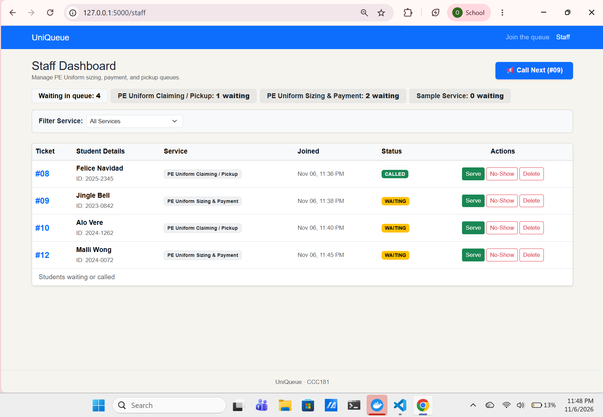
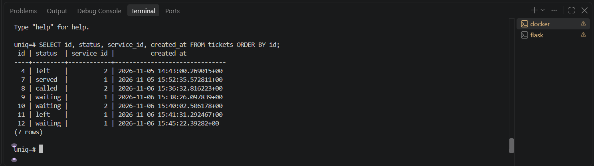
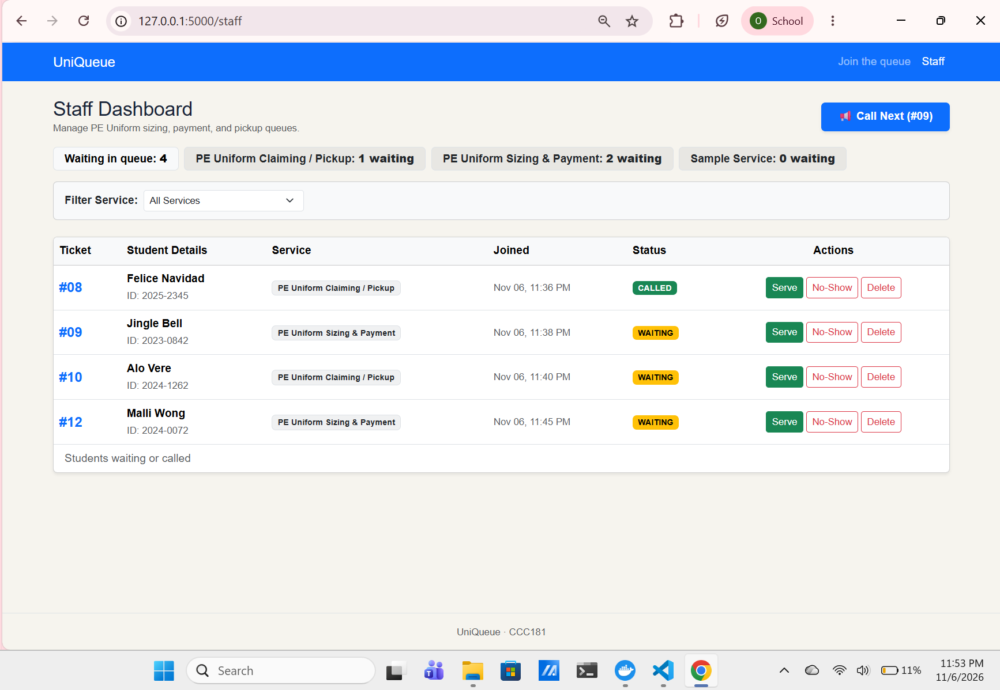
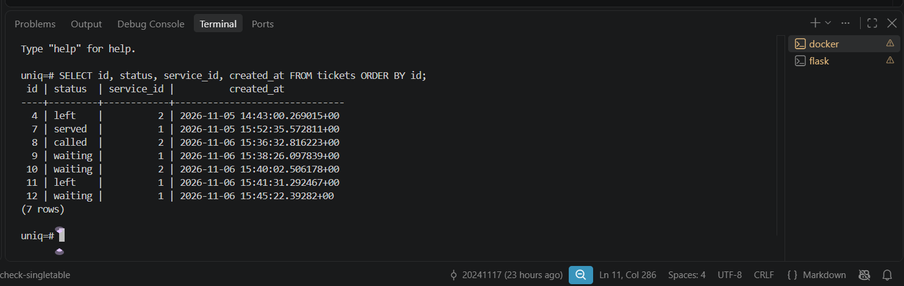

# Persistence Test Log (Part 11a & 11b)

## 11a: Database Persistence After Server Restart

### Step-by-Step Test Procedure

1. **Ticket Creation:** Created 5 tickets across 2 different active services via the join form (`/join`).
2. **Staff Dashboard Actions:**
   * Called ticket #8 (`status` changed to `called`).
   * Served ticket #9 (`status` changed to `served`).
   * Left queue by ticket #11 (`status` changed to `left` via the user queue view).
3. **Before-Restart State Recorded:** Captured screenshots of the staff dashboard and `psql` query `SELECT id, status, service_id, created_at FROM tickets ORDER BY id;` output.
  - **Staff Dashboard:** 

  - **Query output:** 
4. **Environment Shutdown:**
   * Stopped Flask server (`Ctrl + C`).
   * Stopped Docker container: `docker compose down`
   * Verified containers stopped: `docker compose ps`
5. **Environment Restart:**
   * Restarted container: `docker compose up -d`
   * Verified database health: `docker compose ps`
   * Restarted Flask server: `flask --app app run --debug`
6. **After-Restart Verification:** Reloaded `/staff` and ran the SQL query to verify data matching.
  - **Staff Dashboard:** 

  - **Query output:** 
---

## 11b: Rebuild from Scratch

### Commands Executed:
```powershell
docker compose down -v
docker compose up -d
flask --app app db upgrade
flask --app app seed