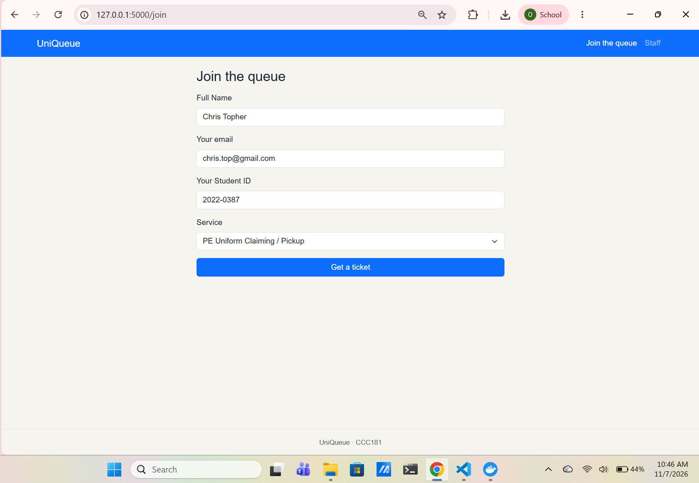
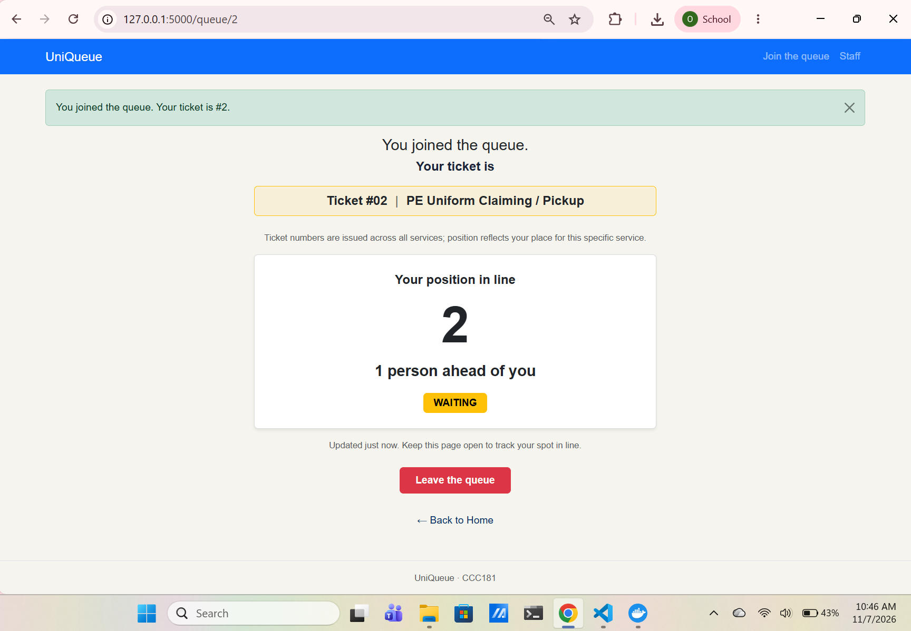
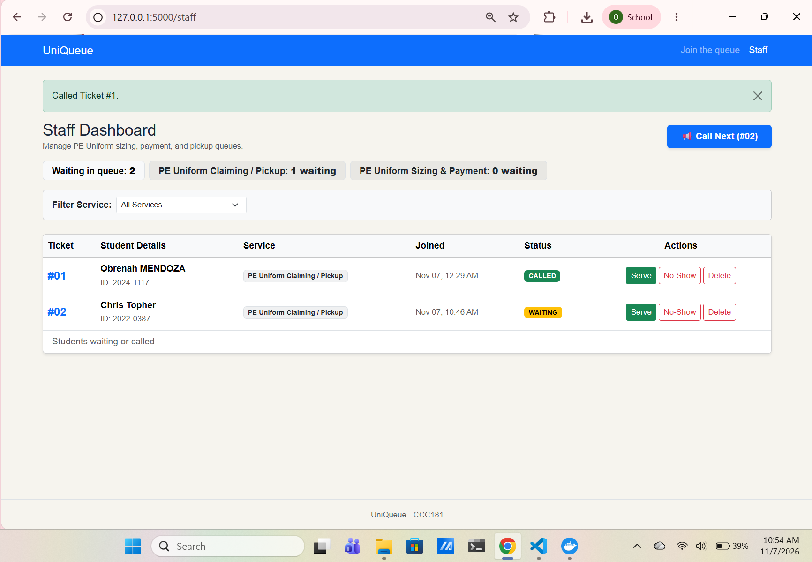
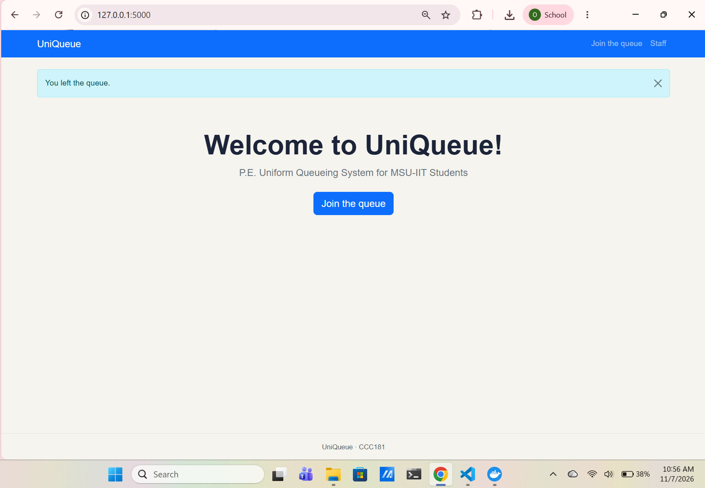
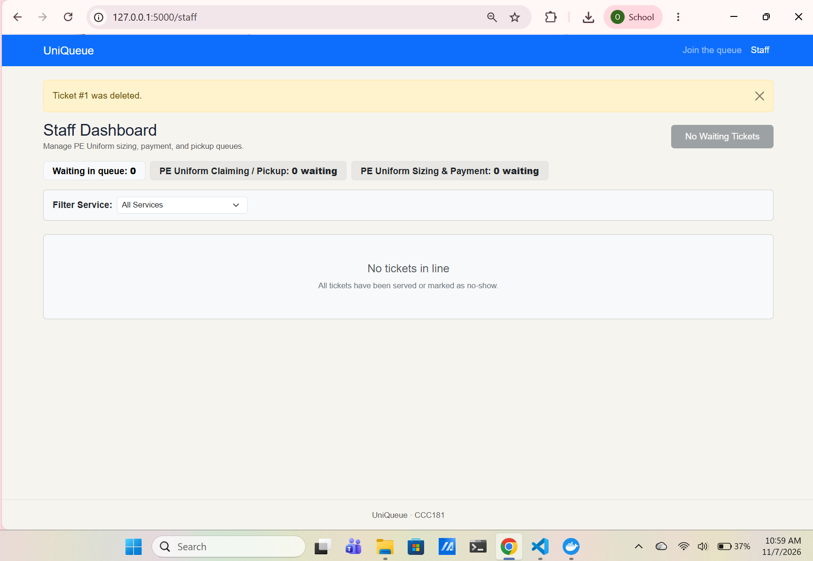

# Week 4 Activity Report: PostgreSQL Persistence & Schema Design

## Title Details
* **App Name:** UniQueue
* **Setting:** University PE Uniform Sizing, Payment, and Pickup Counter 
* **Student Name:** Obrenah Mendoza
* **Student ID:** 2024-1117
* **Section:** CCC181
* **Date:** November 7, 2026
* **Pull Request Link:** https://github.com/aub-zami/CCC181/pull/5

---

## Requirements
* **Functional Requirements:** 10 functional requirements written in `docs/requirements.md` (FR-01 to FR-10), including 3 setting-specific requirements (★) for service management, uniform sizing, and counter assignments.
* **Non-Functional Requirements:** 5 non-functional requirements written (NFR-01 to NFR-05) covering restart reliability, data integrity, performance, accessibility, and security.
* **MVP Scope:** `FR-01`, `FR-02`, `FR-03`, `FR-04`, `FR-05`, `FR-06`, `FR-07`, `NFR-01`, `NFR-02`, `NFR-04`, and `NFR-05`. This provides the minimum complete queue system capable of persisting ticket data reliably without losing student records during counter operation.
* **Stakeholder Feedback:** Consulted a PE Uniform Buyer (Student). Verified that live ticket status tracking (`FR-02`) and clear no-show handling (`FR-04`) effectively resolve student confusion regarding missed turns under the sun.
* **Requirements Link:** [docs/requirements.md](../requirements.md)

---

## ERD
* **Diagram:** ``
* **Relationship Sentences:**
  * One user has many tickets.
  * One service has many tickets.
  * Each ticket belongs to exactly one user and one service.
* **Schema Design Link:** [docs/week4/schema.md](schema.md)

---

## Schema
### `users`
```text
                                      Table "public.users"
   Column   |          Type          | Collation | Nullable |              Default              
------------+------------------------+-----------+----------+-----------------------------------
 id         | integer                |           | not null | nextval('users_id_seq'::regclass)
 name       | character varying(80)  |           | not null | 
 email      | character varying(120) |           | not null | 
 student_id | character varying(20)  |           | not null | 
 role       | character varying(20)  |           | not null | 'visitor'::character varying
Indexes:
    "users_pkey" PRIMARY KEY, btree (id)
    "users_email_key" UNIQUE CONSTRAINT, btree (email)
Check constraints:
    "ck_users_role" CHECK (role::text = ANY (ARRAY['visitor'::character varying, 'staff'::character varying]::text[]))
Referenced by:
    TABLE "tickets" CONSTRAINT "tickets_user_id_fkey" FOREIGN KEY (user_id) REFERENCES users(id) ON DELETE RESTRICT
``` 
### `services`
```text 
                                      Table "public.services"
   Column    |         Type          | Collation | Nullable |               Default                
-------------+-----------------------+-----------+----------+--------------------------------------
 id          | integer               |           | not null | nextval('services_id_seq'::regclass)
 name        | character varying(60) |           | not null | 
 avg_minutes | integer               |           | not null | 
 active      | boolean               |           | not null | true
Indexes:
    "services_pkey" PRIMARY KEY, btree (id)
    "services_name_key" UNIQUE CONSTRAINT, btree (name)
Check constraints:
    "ck_services_avg_minutes" CHECK (avg_minutes > 0)
Referenced by:
    TABLE "tickets" CONSTRAINT "tickets_service_id_fkey" FOREIGN KEY (service_id) REFERENCES services(id) ON DELETE RESTRICT
```

### 'tickets`
```text
                                       Table "public.tickets"
   Column   |           Type           | Collation | Nullable |               Default               
------------+--------------------------+-----------+----------+-------------------------------------
 id         | integer                  |           | not null | nextval('tickets_id_seq'::regclass)
 status     | character varying(20)    |           | not null | 'waiting'::character varying
 created_at | timestamp with time zone |           | not null | now()
 called_at  | timestamp with time zone |           |          | 
 user_id    | integer                  |           | not null | 
 service_id | integer                  |           | not null | 
Indexes:
    "tickets_pkey" PRIMARY KEY, btree (id)
Check constraints:
    "ck_tickets_status" CHECK (status::text = ANY (ARRAY['waiting'::character varying, 'called'::character varying, 'served'::character varying, 'no-show'::character varying, 'left'::character varying]::text[]))
Foreign-key constraints:
    "tickets_service_id_fkey" FOREIGN KEY (service_id) REFERENCES services(id) ON DELETE RESTRICT
    "tickets_user_id_fkey" FOREIGN KEY (user_id) REFERENCES users(id) ON DELETE RESTRICT
```

## Design Decisions
1. **`student_id` in `users`:** Stored directly in the `users` table to maintain 3NF normalization, ensuring student identification is recorded once per student account rather than duplicated across every ticket created.
2. **`RESTRICT` on Foreign Keys:** Foreign keys enforce `ON DELETE RESTRICT` so that deleting a service or user with active/past ticket history is blocked, preserving historical queue logs for staff reports.
3. **Soft Delete for Left Queue:** When a student leaves the queue, status is updated to `'left'` rather than deleting the database row, allowing staff to analyze drop-off rates and peak counter congestion.

---

## Self-Review
Key schema adjustments made during review (from `schema-review.md`):
* **Facts, Not Results:** Avoided storing a `position_in_line` integer column on `tickets` to prevent cascading SQL updates on line shifts, choosing instead to compute queue position dynamically using `created_at` timestamp comparison (`COUNT()`).
* **Non-Destructive Toggling:** Added an `active` boolean column (`NOT NULL DEFAULT true`) to `services` so staff can soft-disable temporary counters (e.g., Payment counter) without deleting service history or breaking existing ticket references.
* **Audit Integrity:** Retained `ON DELETE RESTRICT` on `tickets.service_id` and `tickets.user_id` to block deletions if historical tickets reference them.

---

## Migrations
* `migrations/versions/9a1b2c3d4e5f_initial_tables.py`: Initial migration creating the core `users`, `services`, and `tickets` tables along with primary keys, foreign keys, CHECK constraints, and defaults.
* `migrations/versions/8f7e6d5c4b3a_add_active_column_to_services.py`: Second migration adding the `active` boolean column (`server_default=true()`) to the `services` table.

---

## CRUD Operations
* **Create:** `@app.post("/join")` (FR-01, FR-06) - Saves student user details and generates a ticket row. 
  * Screenshot: 
* **Read:** `@app.get("/queue/<int:ticket_id>")` & `@app.get("/staff")` (FR-02, FR-03) - Displays My Place live ticket status and the staff dashboard queue list.
  * Screenshot: 
* **Update:** `@app.post("/staff/tickets/<int:ticket_id>/<action>")` (FR-04) - Updates ticket status (`called`, `served`, `no-show`) and records `called_at` timestamps.
  * Screenshot: 
* **Soft Delete:** `@app.post("/queue/<int:ticket_id>/leave")` (FR-05) - Sets ticket status to `'left'` while keeping row intact for staff analytics.
  * Screenshot: 
* **Hard Delete:** `@app.post("/staff/tickets/<int:ticket_id>/delete")` - Permanently removes mistaken or test tickets after user confirmation.
  * Screenshot: 

---

## Validation
* Summary of findings from `validation.md`: Validation is structured across 3 layers (Browser HTML attributes, Flask route validation returning `400 Bad Request`, and PostgreSQL database constraints).
* **Most Useful Error:** `ERROR: duplicate key value violates unique constraint "users_email_key" DETAIL: Key (email)=(...) already exists.` This error explicitly prevents account duplication when students rejoin the queue with existing email addresses.

---

## Persistence
* **NFR-01 Result:** Passed. All ticket states, user associations, and created timestamps persisted identically across server and Docker container shutdowns (`docker compose down` and `docker compose up -d`).
* **Rebuild Test Result:** Passed. Executed `docker compose down -v`, `docker compose up -d`, `flask --app app db upgrade`, and `flask --app app seed`. Database cleanly recreated tables from migration scripts and seeded starting services without errors.
* Before and after screenshots documented in [docs/week4/persistence.md](persistence.md).

---

## Reflection
* **Hardest Challenge:** Handling `sqlalchemy.exc.IntegrityError` safely with explicit `db.session.rollback()` calls to avoid leaving transactions in an invalid state when duplicate user emails or invalid foreign keys were submitted.
* **Hardest Requirement to Write Testably:** `NFR-02` (Data Integrity), ensuring that simultaneous form submissions can never generate duplicate primary keys or ticket positions under high concurrent server loads.
* **Week 5 Reporting Query:** `SELECT service_id, COUNT(*) AS left_count FROM tickets WHERE status = 'left' GROUP BY service_id;`

---

## Declaration
* AI tools (Gemini) were used for step-by-step code walkthroughs, database constraint troubleshooting, and Markdown documentation formatting.