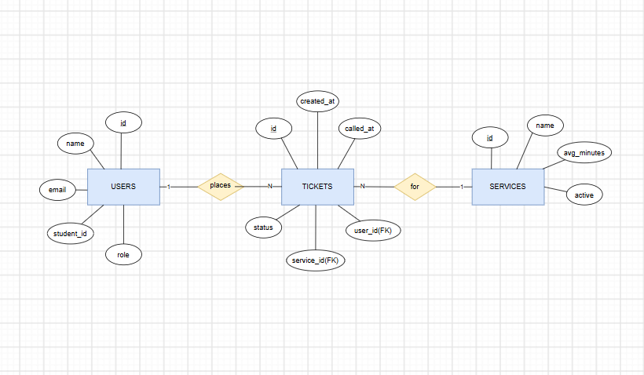

# UniQueue Database Schema & ERD

## 2a. Nouns & Candidate Entities

| Req ID | Requirement | Nouns | Table or column? |
| --- | --- | --- | --- |
| FR-01 | A student can join the queue for a service by entering their name and email. | student, queue, service, name, email | `users`, *(computed status)*, `services`, `users.name`, `users.email` |
| FR-02 | A student can see their ticket number, status, and how many people are ahead of them. | ticket number, status, ahead | `tickets.id`, `tickets.status`, *(computed count)* |
| FR-06 ★ | A student can enter their Student ID number when joining the queue. | student ID | `users.student_id` |
| FR-07 | A staff member can add, rename, and switch off a service. | service, name, active | `services`, `services.name`, `services.active` |

---

## 2b. Tables & Columns

Start from ClinicQ's three tables and adapted for UniQueue (PE Uniform Counter):

| Table | UniQueue columns |
| --- | --- |
| `users` | id, name, email, student_id, role |
| `services` | id, name, avg_minutes, active |
| `tickets` | id, user_id, service_id, status, created_at, called_at |

---

## 2c. Types & Constraints

| Table | Column | PostgreSQL type | Constraint | Why |
| --- | --- | --- | --- | --- |
| `users` | `id` | integer, generated | PRIMARY KEY | Unique identifier for each user |
| `users` | `name` | varchar(80) | NOT NULL | Student/Staff full name |
| `users` | `email` | varchar(120) | NOT NULL UNIQUE | One account per email address |
| `users` | `student_id` | varchar(20) | NOT NULL | Setting-specific Student ID (FR-06) |
| `users` | `role` | varchar(20) | NOT NULL, CHECK (role IN ('visitor', 'staff')) | User permission levels |
| `services` | `id` | integer, generated | PRIMARY KEY | Unique service identifier |
| `services` | `name` | varchar(60) | NOT NULL UNIQUE | Service title |
| `services` | `avg_minutes` | integer | CHECK (avg_minutes > 0) | Estimated queue processing time |
| `services` | `active` | boolean | NOT NULL DEFAULT true | Toggles non-destructive availability of a service |
| `tickets` | `id` | integer, generated | PRIMARY KEY | Ticket number, generated automatically |
| `tickets` | `status` | varchar(20) | NOT NULL, CHECK (status IN ('waiting', 'called', 'served', 'no-show', 'left')) | Current ticket queue state |
| `tickets` | `created_at` | timestamptz | NOT NULL DEFAULT now() | Time joined (timezone-aware) |
| `tickets` | `called_at` | timestamptz | NULL | Timestamp when called by staff |
| `tickets` | `user_id` | integer | NOT NULL REFERENCES users(id) ON DELETE RESTRICT | Foreign key linking ticket to user |
| `tickets` | `service_id` | integer | NOT NULL REFERENCES services(id) ON DELETE RESTRICT | Foreign key linking ticket to service |

---

## 2d. Entity-Relationship Diagram (ERD)

### Relationships
- One user has many tickets.
- One service has many tickets.
- Each ticket belongs to exactly one user and one service.

### Delete Rules
- **`ON DELETE RESTRICT` (Foreign Keys):** Deleting a user or service is blocked if existing ticket records depend on them, preserving historical queue data for staff reports.

---

## 2e. Normalization Self-Check 

1. **One value per cell (1NF):** Every cell holds a single scalar value. No comma-separated strings or lists are stored.
2. **Depends on the whole key (2NF):** All non-key columns depend entirely on their table's primary key.
3. **No hidden copies  (3NF):** No non-key attributes depend on other non-key attributes. User attributes stay in `users`, service details stay in `services`.